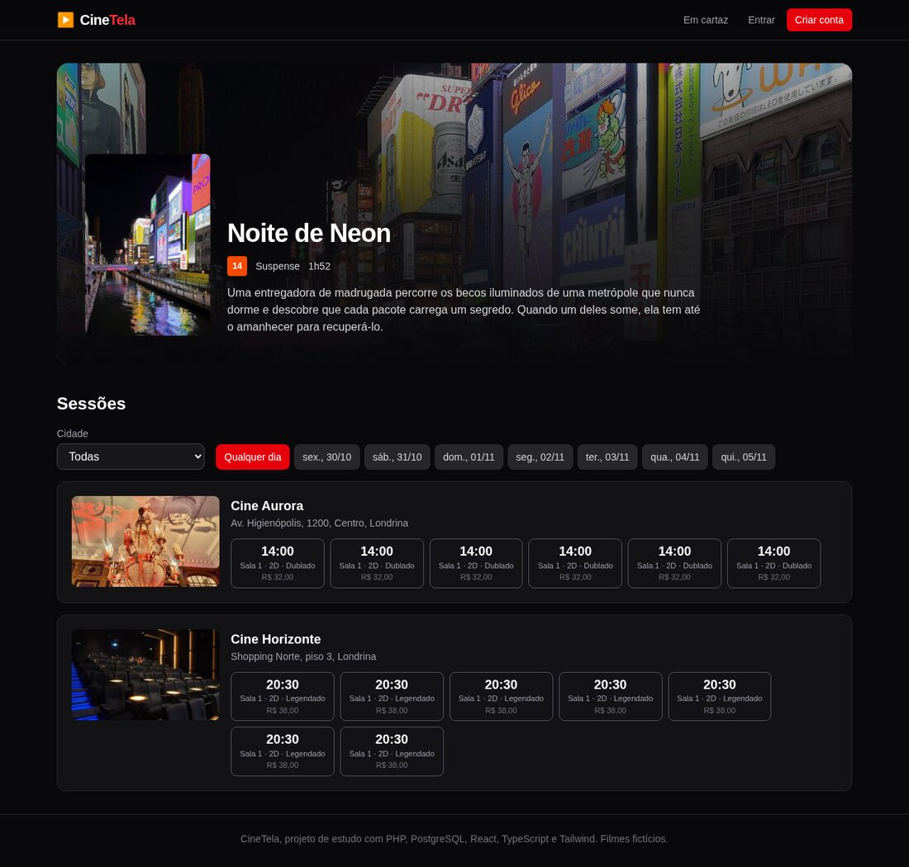
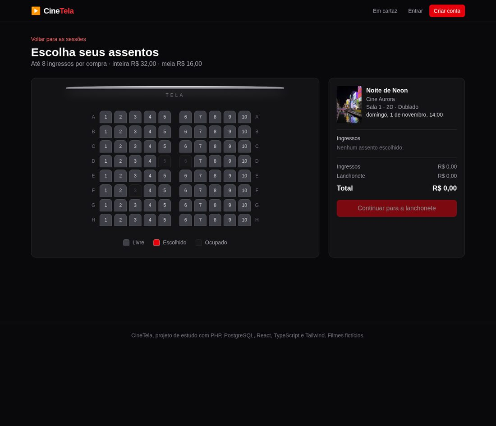
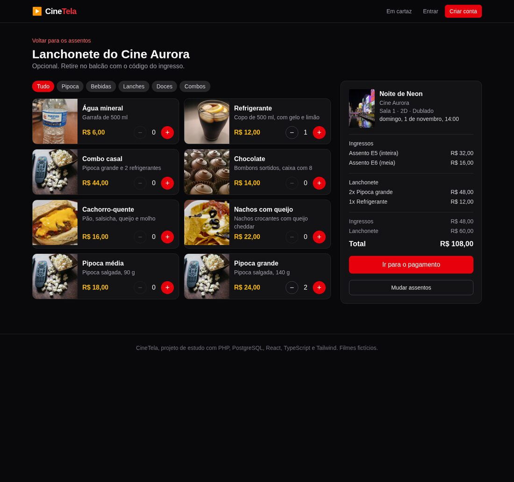

# CineTela

App de cinema completo: o cliente escolhe filme, sessão e assentos, pede lanchonete e paga; o gerente cuida do
próprio cinema; o administrador tem controle total.

## Ficha técnica

| | |
|---|---|
| **Linguagens** | PHP (back, 33 arquivos, cerca de 3 000 linhas), TypeScript e TSX (front, 63 arquivos, cerca de 3 900 linhas), SQL (banco, 219 linhas) |
| **Back** | PHP 8.4 puro, sem framework: API JSON com 39 rotas, PDO e Composer só para o autoload |
| **Banco** | PostgreSQL 18, com 10 tabelas |
| **Front** | React 19, TypeScript 6, Tailwind 4, Vite 8 e React Router 8 |
| **Infra** | Docker Compose, com três containers (banco, API e front) |
| **Papéis** | visitante, cliente, gerente de cinema e administrador |
| **Autenticação** | token aleatório (Bearer) guardado no banco, com validade de 7 dias |

## Descrição

Cada parte roda no seu container, e o `docker-compose.yml` liga as três:

- **Banco (`db`):** um PostgreSQL 18. Na primeira subida ele executa sozinho `backend/database/01-schema.sql`
  (tabelas) e `02-seed.sql` (3 cinemas, 9 filmes, sessões dos próximos 7 dias e a lanchonete de cada cinema).
- **API (`backend`, PHP, porta 8000):** o servidor embutido do PHP manda toda requisição para `public/index.php`.
  Dali, o `Router` escolhe o controller, o controller chama um repositório (que tem todo o SQL) e a resposta volta
  em JSON. O back também cuida do que não pode ficar no navegador: calcula o preço do pedido, grava pedido,
  ingressos e itens numa transação e impede vender o mesmo assento duas vezes (um índice único do banco).
- **App (`frontend`, React, porta 5173):** o Vite serve as telas e repassa tudo que começa com `/api` para o
  container da API. O estado de login fica no navegador (`localStorage`), e a compra em andamento no
  `sessionStorage`. Os filtros da página inicial ficam na URL.

## Como rodar

Precisa de [Docker](https://docs.docker.com/get-docker/) com Compose. Na pasta do projeto:

```bash
docker compose up --build --renew-anon-volumes
```

Se tiver o [mise](https://mise.jdx.dev) instalado, o mesmo em um comando só, que sobe tudo em segundo plano, espera a
API responder e mostra onde abrir:

```bash
mise run start
```

Na primeira vez demora um pouco (baixa as imagens e instala as dependências). Quando os três containers subirem:

- **App:** http://localhost:5173
- **API:** http://localhost:8000 (teste em http://localhost:8000/api/saude, que deve responder `{"status":"ok","banco":"ok"}`)

Para parar, `Ctrl+C` no terminal (ou `docker compose down` em outro, ou `mise run down` se subiu com o mise). Os dados
do banco ficam guardados.

**Contas de teste** (senha `senha123` para todas):

| E-mail | Papel | O que dá para fazer |
|---|---|---|
| `cliente@cine.dev` | cliente | escolher assentos, comprar e cancelar pedidos |
| `gerente@cine.dev` | gerente do Cine Aurora | gerenciar salas, sessões, lanchonete e vendas do próprio cinema |
| `admin@cine.dev` | administrador | gerenciar filmes, cinemas e usuários, e ver o relatório geral |

Sem entrar, dá para navegar, filtrar os filmes e escolher assentos. Só o pagamento exige conta. Para pagar, use o
cartão de teste `4111 1111 1111 1111`, validade `12/35`, código `123` (nenhum cartão é cobrado nem guardado).

**Quando algo der errado:**

- Ver os erros da API: `docker compose logs -f backend`.
- Recriar o banco do zero (apaga os dados e renova as sessões, que são geradas para os 7 dias seguintes à criação do
  banco): `docker compose down -v` e depois `docker compose up --build --renew-anon-volumes`. Faça isso também depois
  de alterar `01-schema.sql` ou `02-seed.sql`, porque o Postgres só os executa com o banco vazio.
- Porta 5173 ou 8000 em uso: feche o que a usa, ou mude o número à esquerda do `:` em `ports` no
  `docker-compose.yml`.

## Imagens (visão de visitante, sem entrar)

**Em cartaz:** os filmes, com busca por título e filtro de gênero.


**Página do filme:** sinopse e as sessões de cada cinema, com horário, sala, formato e preço.



**Escolha de assentos:** o mapa da sala, com os lugares já vendidos apagados.



**Lanchonete:** o que cada cinema vende, com o resumo da compra ao lado.



## Demonstração no GitHub Pages

O endereço do GitHub Pages deste repositório mostra o app **como visitante**, sem servidor: o front lê dados fixos
(`frontend/public/demo/dados.json`) no lugar da API. Entrar e comprar só funcionam rodando o projeto como descrito
acima.
